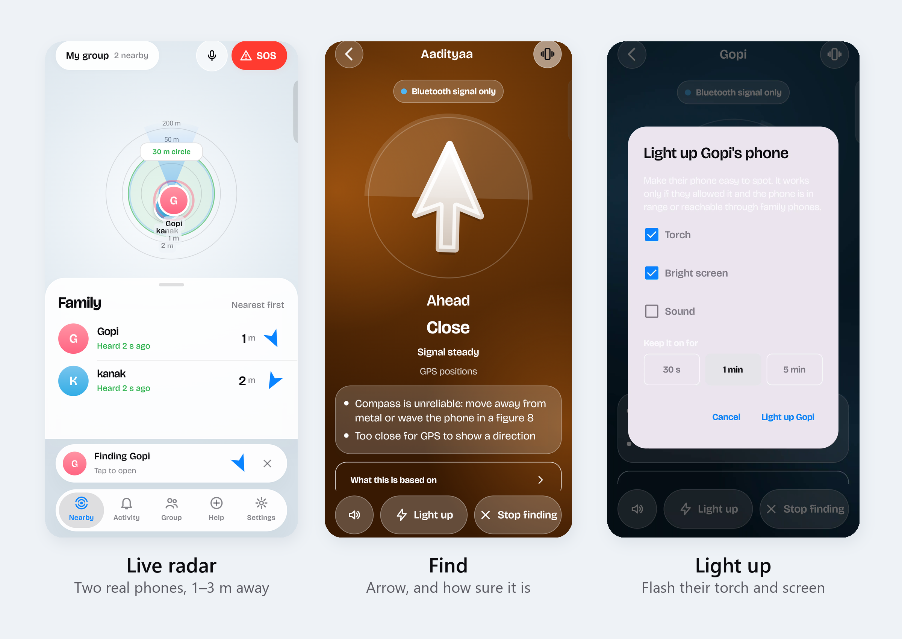
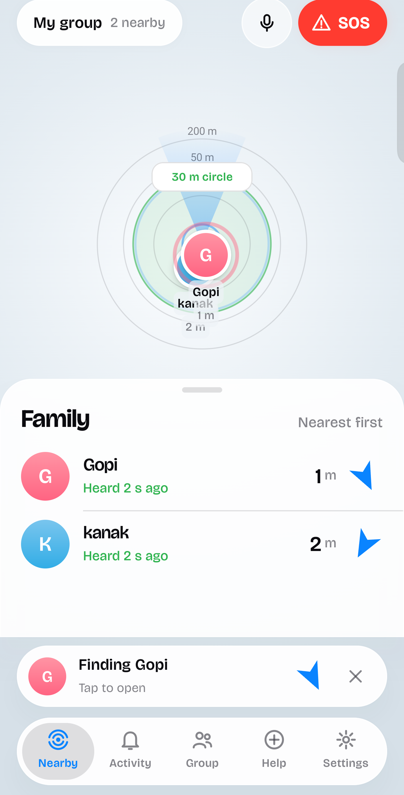
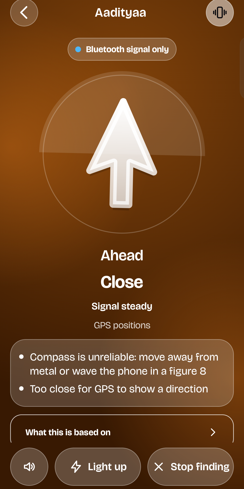
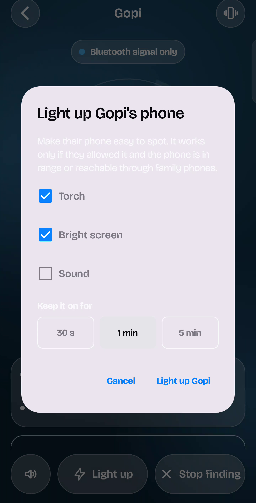
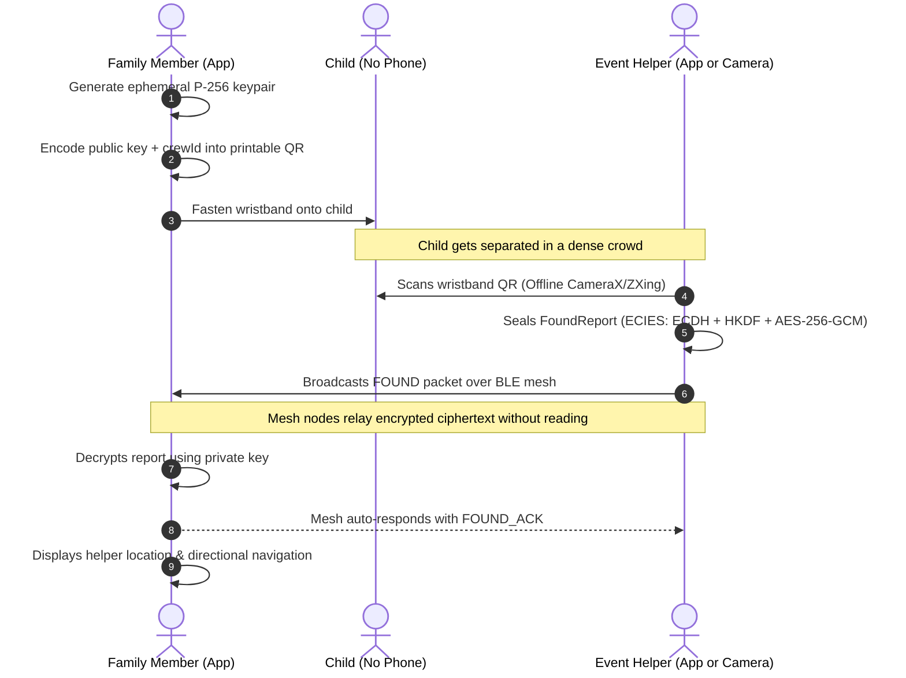
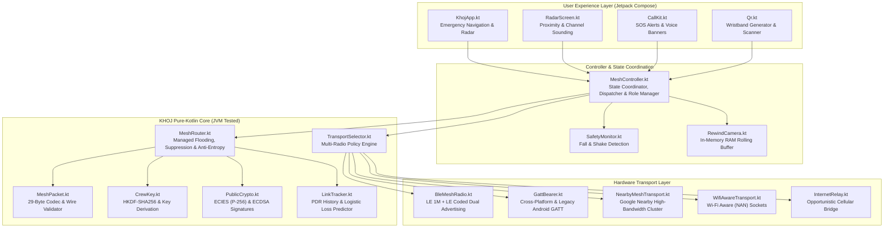
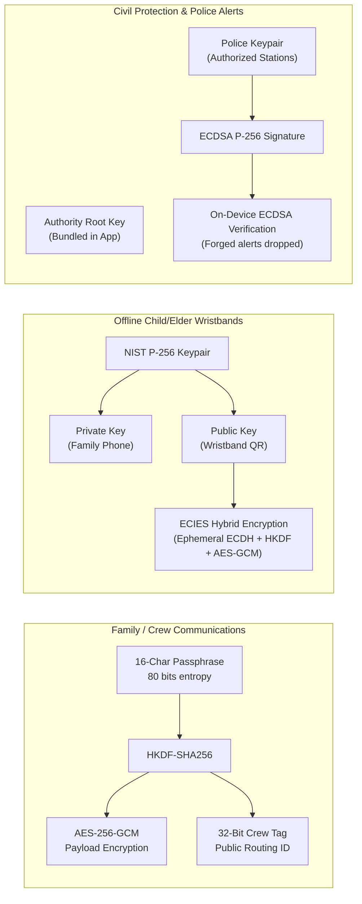

# KHOJ (खोज) · Offline Crowd Mesh & Life-Safety Network

<div align="center">



### *Decentralized peer-to-peer family finding, life-safety alerts, and child/elder reunification for dense, network-denied crowds.*

[-3DDC84?style=for-the-badge&logo=android&logoColor=white)](https://developer.android.com)
[](https://kotlinlang.org)
[-00C853?style=for-the-badge&logo=checkmarx&logoColor=white)](file:///core/src/test/kotlin)
[-FF8F00?style=for-the-badge&logo=qualcomm&logoColor=white)](docs/DEVICE_PROFILE_IQOO.md)
[](docs/MESH.md)
[](app/src/main/res)
[](docs/ARCHITECTURE.md)

[**Explore Architecture**](docs/ARCHITECTURE.md) • [**App Walkthrough**](docs/KHOJ_APP.md) • [**Device Benchmarks**](docs/DEVICE_PROFILE_IQOO.md) • [**Find Member Engine**](docs/FIND_MEMBER_ARCHITECTURE.md) • [**GATT Bearer Spec**](docs/GATT_BEARER.md)

</div>

---

## ⚡ Executive Summary

In massive religious gatherings (such as the Kumbh Mela), music festivals, sports stadiums, protests, and transport terminals, cellular networks reliably saturate and fail. When a family member or friend gets separated, conventional tracking apps—which demand active cell towers, cloud backends, and GPS map tiles—become completely useless. Furthermore, vulnerable individuals such as small children and elderly pilgrims often carry **no phone at all**.

**KHOJ (Hindi for *"Search"*, engineering name: `LinkFill AI` / `app.linkfill`)** is an emergency-first, peer-to-peer localization and safety system built from the silicon up for zero-connectivity environments:

1. **Self-Healing BLE Multi-Hop Mesh:** Converts off-the-shelf Android smartphones into mesh routers using Bluetooth LE 5.0/6.0 advertising without requiring pairing, internet, or centralized servers.
2. **AirTag-Style Directional Finding:** A 5-tiered localization engine leveraging **Bluetooth 6.0 Channel Sounding**, L-turn walking-direction dead reckoning, and true-north compass heading with dynamic uncertainty wedges.
3. **Zero-Phone Wristbands (Offline vCard QR):** Printable wristbands for children and elders with embedded P-256 cryptographic public keys. Any helper's camera can scan the wristband offline; the generated "Found" report is ECIES-sealed and routed across the mesh—**readable exclusively by the family's phone**.
4. **Life-Safety & Emergency Dispatch:** 2-second hold-to-SOS with full-volume alarm override, dual-stage accelerometer fall detection, panic shake gesture, and a 3-minute rolling in-memory Rewind camera buffer.
5. **Civil Authority & Police Mesh:** Real-time triage dashboard for event volunteers and medical responders, featuring tamper-proof emergency broadcasts cryptographically signed via ECDSA P-256 authority keys.
6. **On-Device Multilingual Voice Engine:** Natural language spoken assistant and voice commands in 6 Indian languages (*English, Hindi, Marathi, Telugu, Bengali, Tamil*).

---

## 📱 User Interface & Visual Showcase

The KHOJ user interface was engineered under the design principle of **"Calm by default, unmistakably clear in an emergency"**. It employs a high-contrast, dark glassmorphic design system with oversized touch targets (48dp+), glanceable status strips, and micro-haptic directional guidance.

<div align="center">

| 🛰️ Proximity Radar | 🎯 Precision Finder | 🔦 Remote Light-Up Beacon |
| :---: | :---: | :---: |
|  |  |  |
| *Real-time distance bands, link quality, and battery tracking.* | *Hardware ranging + compass arrow with uncertainty wedge.* | *Remotely triggers high-beam torch, display strobe & acoustic alarm.* |

</div>

> 🎥 **Video Demos:** Check out our narrated end-to-end demo at [`docs/demo/khoj_demo_narrated.mp4`](docs/demo/khoj_demo_narrated.mp4) and [`docs/demo/khoj_demo_part1.mp4`](docs/demo/khoj_demo_part1.mp4).

---

## 🌟 Core Technical Highlights

### 1. Multi-Tier Precision Finding Engine
When finding a separated member, KHOJ automatically selects the highest-fidelity localization source available and provides transparent confidence feedback:

```
[Target Beacon Received]
          │
          ├──► Android 16 Ranging API (Bluetooth Channel Sounding / UWB / Wi-Fi RTT)
          │    └── Hardware Distance + Precise Distance Bands (Sub-meter accuracy)
          │
          ├──► Walking Direction Odometry (L-Turn Filter)
          │    └── Triangulates heading via accelerometer steps + compass + RSSI regression
          │
          ├──► GPS Fused Vector + Rotation Sensor Heading
          │    └── High-contrast directional arrow with ±15° dynamic uncertainty wedge
          │
          └──► Filtered BLE Proximity (RSSI Kalman / Median Filter)
               └── Signal strength trend, haptic cues, proximity bands (Never an invented arrow)
```

| Tier | Source | User Presentation | Honesty Guarantee |
|:---|:---|:---|:---|
| **Tier 1: Walking Direction** | Step detector + rotation vector + range fitting while walking an "L" path | Estimated arrow with confidence wedge | Prompts user to turn a 90° corner if heading is ambiguous |
| **Tier 2: Hardware Ranging** | Android 16 Ranging API (Bluetooth 6.0 Channel Sounding) | Real hardware distance; directional angle if silicon supports AoA | Measured on Qualcomm SM8850: Distance enabled, no angle |
| **Tier 3: GPS Bearing** | Fused GNSS coordinates + True-North Compass | Arrow with dynamic uncertainty wedge | Suppressed if fix is older than 20s or distance is within GPS error margin |
| **Tier 4: BLE Proximity** | Filtered frame RSSI & moving average | Near / Mid / Far closeness bands + haptic vibration rhythm | **Never fabricates an arrow** from signal strength alone |
| **Tier 5: Last Known** | Stored historical coordinates & dead reckoning | Stored position marker with exact timestamp age | Labeled as "Estimated" if dead reckoning is active |

---

### 2. Zero-Phone Wristband Reunification (P-256 ECIES)
Children and elderly individuals often do not carry smartphones. KHOJ introduces an offline cryptographic wristband workflow:



- **Universal Offline Compatibility:** The wristband QR is formatted as a standard vCard / text format, allowing any smartphone camera without KHOJ to immediately see the family's contact details.
- **Zero Metadata Leakage:** The `FoundReport` is cryptographically sealed to the band's public key with `crewId ‖ bandId` associated data. Mesh relays see only random ciphertext.

---

### 3. Emergency-First Life Safety: SOS & Pendant Mode
Designed for high-stress scenarios where complex navigation is impossible:

- **2-Second Hold-to-SOS:** Requires a deliberate 2-second press with an animated haptic ring. Instantly switches the radio stack to maximum power for 10 minutes, boosts BLE advertising frequency, and triggers Nearby Connections.
- **Alarm Stream Decibel Override:** Plays a high-decibel rising/falling siren on the Android `STREAM_ALARM` channel at maximum volume (restoring prior system volume upon disarm).
- **Dual-Stage Fall Detection (`Motion.kt`):**
  1. *Free Fall Stage:* Linear acceleration magnitude drops below $0.45\text{ g}$ for $>60\text{ ms}$.
  2. *Impact Stage:* Sharp acceleration peak exceeding $2.2\text{ g}$ within $800\text{ ms}$.
  3. *Stillness Stage:* Motion standard deviation stays below $1.2\text{ m/s}^2$ for $2.0\text{ s}$.
- **Panic Shake Detector:** 4 consecutive acceleration spikes $>2.5\text{ g}$ within 2 seconds.
- **Rewind Camera Buffer:** Captures rolling low-power forward-facing photos every 3 seconds while worn as a pendant. Stored **exclusively in RAM for 3 minutes** with GPS coordinates; automatically erased on shutdown, with zero cloud upload.

---

### 4. Decentralized BLE Multi-Hop Protocol

The KHOJ mesh operates over a compact, big-endian **29-byte binary header** designed to fit inside standard BLE 5.0 extended advertising frames, legacy packets, and LoRa payloads ($\le 200\text{ bytes}$ total):

```
 0                   1                   2                   3
 0 1 2 3 4 5 6 7 8 9 0 1 2 3 4 5 6 7 8 9 0 1 2 3 4 5 6 7 8 9 0 1
+-+-+-+-+-+-+-+-+-+-+-+-+-+-+-+-+-+-+-+-+-+-+-+-+-+-+-+-+-+-+-+-+
|   Magic ('K') |    Version    |  Packet Type  |     Flags     |
+-+-+-+-+-+-+-+-+-+-+-+-+-+-+-+-+-+-+-+-+-+-+-+-+-+-+-+-+-+-+-+-+
|      TTL      |   Hop Count   |          Link Sequence        |
+-+-+-+-+-+-+-+-+-+-+-+-+-+-+-+-+-+-+-+-+-+-+-+-+-+-+-+-+-+-+-+-+
|                           Relay ID                            |
+-+-+-+-+-+-+-+-+-+-+-+-+-+-+-+-+-+-+-+-+-+-+-+-+-+-+-+-+-+-+-+-+
|                            Crew ID                            |
+-+-+-+-+-+-+-+-+-+-+-+-+-+-+-+-+-+-+-+-+-+-+-+-+-+-+-+-+-+-+-+-+
|                           Origin ID                           |
+-+-+-+-+-+-+-+-+-+-+-+-+-+-+-+-+-+-+-+-+-+-+-+-+-+-+-+-+-+-+-+-+
|                           Packet ID                           |
+-+-+-+-+-+-+-+-+-+-+-+-+-+-+-+-+-+-+-+-+-+-+-+-+-+-+-+-+-+-+-+-+
|                          Origin Time                          |
+-+-+-+-+-+-+-+-+-+-+-+-+-+-+-+-+-+-+-+-+-+-+-+-+-+-+-+-+-+-+-+-+
|  Payload Len  |        Payload (AES-256-GCM / Cleartext)      |
+-+-+-+-+-+-+-+-+-+-+-+-+-+-+-+-+-+-+-+-+-+-+-+-+-+-+-+-+-+-+-+-+
```

#### Managed Flooding Mechanics
- **Distance-Biased Relay Delay:** Relays do not broadcast simultaneously. A relay delay is computed as:
  $$\Delta t = 40\text{ ms} + (\text{RSSI}_{\text{norm}} \times 400\text{ ms}) + \text{Uniform}(0, 250\text{ ms})$$
  Nodes with **weaker received signal** (further away at the network perimeter) relay first, propagating packets outward rapidly while suppressing redundant center transmissions.
- **Suppression:** If a node overhears 2 or more other relays of the same packet ID before its scheduled timer fires, its relay is cancelled.
- **Store-Carry-Forward (Anti-Entropy):** Nodes maintain a rolling cache of the last 32 urgent packets (SOS, RALLY, FOUND). When a new node appears after an outage, cached packets are automatically bridged.
- **Battery-Saver Duty Cycling:** Nodes below 15% battery switch to low-power beaconing (15s interval) and abstain from relaying; neighboring full-power nodes automatically take over.

---

## 🏛️ System Architecture



---

## 🔬 Measured Hardware Profile & Empirical Benchmarks

### 1. Real Silicon Measurements: Qualcomm Snapdragon 8 Elite (SM8850)
All hardware capabilities and power profiles were directly measured and verified on an **iQOO 13 / I2501** running Android 16:

| Subsystem | Silicon Capability | KHOJ Implementation |
|:---|:---|:---|
| **Bluetooth Core** | Bluetooth 6.0 Core Specification | Dual concurrent advertising sets (LE 1M + LE Coded PHY) |
| **Channel Sounding** | Supported (Phase & RTT Ranging) | Integrated via Android 16 Ranging API for hardware distance |
| **Advertising Sets** | 16 hardware advertising sets supported | 2 sets active: Set 0 (1M Legacy/Ext), Set 1 (LE Coded Long-Range) |
| **Scan Filters** | 64 hardware-offloaded scan filters | Filter offloaded to Bluetooth controller; zero CPU wakeups for foreign packets |
| **Transmit Power** | Power Class 1 hardware (+20 dBm) | Android framework caps app TX power at **+1 dBm** |
| **Wi-Fi Radios** | Wi-Fi Direct: Yes • Wi-Fi Aware: No • Wi-Fi RTT: No | Wi-Fi Aware safely disabled via feature check; GATT & Nearby utilized |

### 2. Power Consumption & CPU Utilization
Continuous high-frequency scanning can drain an Android device in hours. KHOJ implements an adaptive duty cycle:

```
[Continuous Nearby Connections Enabled]  ──────► ~10% System Bluetooth CPU
[KHOJ Adaptive Scan + Duty Cycle]       ──────► ~1.0% App CPU / ~3.0% Bluetooth Stack
```
- **Screen-Off Persistence:** Hardware-offloaded 16-bit Service UUID filters allow the application to receive emergency mesh broadcasts while the device CPU remains in deep sleep.
- **Throttling Guard:** Limits scan mode transitions to once per 30 seconds, adhering strictly to Android's 5-scan-per-30s system throttle limit.

### 3. Machine Learning Link Loss Predictor
Using a 21-feature window (sequence gaps, packet delivery ratio, RSSI spread, consecutive drops), KHOJ predicts link failure **before** packets are lost:

<div align="center">

| Feature Set | PR-AUC (Loss in next 0.6s) | Recall @ 10% False Alarm Rate |
|:---|:---:|:---:|
| Distance-Only Baseline | 0.47 | 25.1% |
| RSSI-Only Metric | 0.69 | 48.3% |
| Packet Delivery Ratio (PDR) History | 0.81 | 70.2% |
| **Full Combined Feature Space (KHOJ)** | **0.83** | **73.4%** |

</div>

> 📊 Detailed benchmark telemetry and evaluation logs are documented in [`docs/LINK_PREDICTOR_RESULTS.md`](docs/LINK_PREDICTOR_RESULTS.md) and [`docs/MESH_RANGE_RESULTS.md`](docs/MESH_RANGE_RESULTS.md).

---

## 🔐 Security & Cryptographic Model

KHOJ enforces defense-in-depth cryptography. Because mesh packets are relayed through untrusted devices, all sensitive data is end-to-end encrypted:



| Asset / Stream | Cryptographic Mechanism | Protection Level |
|:---|:---|:---|
| **Family Beacons & Chat** | AES-256-GCM with HKDF-derived key | End-to-end encrypted. Relaying phones cannot read payload or metadata. |
| **Child/Elder Found Reports** | ECIES (NIST P-256 + HKDF + AES-GCM) | Publicly sealable by any helper; decryptable strictly by the family device. |
| **Civil Police Alerts** | ECDSA P-256 against bundled authority key | Tamper-proof. Forged or unauthorized broadcasts are dropped silently. |
| **Anti-Replay / Nonce Safety** | 96-bit Nonces: `(OriginId, PacketId, CrewId)` | Guarantees nonces never collide across device reboots or clock resets. |
| **Denial-of-Service Defense** | Leaky-bucket relay limiter (max 5 public/10s) | Prevents compromised nodes from saturating emergency helper boards. |

---

## 🧪 Testing & Verification

KHOJ maintains an uncompromising stance on engineering honesty: pure-Kotlin architecture cleanly decouples routing logic, packet framing, and cryptographic protocols from Android framework dependencies, enabling comprehensive deterministic verification:

```bash
# Execute the full JVM automated test suite (106 unit tests, 0 failures)
./gradlew :core:test

# Execute the Node.js cellular relay bridge tests
cd relay && node --test
```

### Automated Test Coverage Breakdown

| Test Suite | File Location | Key Verifications Covered |
|:---|:---|:---|
| **`ProtocolTest`** | [`core/.../ProtocolTest.kt`](core/src/test/kotlin/app/linkfill/core/ProtocolTest.kt) | 29-byte envelope encoding, malformed inputs, clock skew rejection, length boundaries. |
| **`MeshTest`** | [`core/.../MeshTest.kt`](core/src/test/kotlin/app/linkfill/core/MeshTest.kt) | Flooding hops, non-crew relaying, TTL decrements, suppression logic, forged packet drops. |
| **`SafetyTest`** | [`core/.../SafetyTest.kt`](core/src/test/kotlin/app/linkfill/core/SafetyTest.kt) | P-256 key compression, ECIES sealing/opening, ZXing QR round-trips, fall & shake synthetic models. |
| **`GroupSafetyTest`**| [`core/.../GroupSafetyTest.kt`](core/src/test/kotlin/app/linkfill/core/GroupSafetyTest.kt) | Group circle boundary hysteresis, store-carry-forward delivery to late arrivals, GATT MTU framing. |
| **`RangeBearingTest`**| [`core/.../RangeBearingTest.kt`](core/src/test/kotlin/app/linkfill/core/RangeBearingTest.kt) | L-turn walking odometry regression and convergence under noisy synthetic step counts. |
| **`InteropVectorsTest`**| [`core/.../InteropVectorsTest.kt`](core/src/test/kotlin/app/linkfill/core/InteropVectorsTest.kt) | Cross-platform test vectors for iOS Swift interoperability ([`docs/interop/`](docs/interop/)). |

---

## 🛠️ Build, Installation & Quickstart

### Prerequisites
- **Android Studio Ladybug / Meerkat** (or newer) with JDK 17+
- **Android SDK Platform 36** (API Level 36, minSdk 29)
- **Physical Android Device** with Bluetooth LE (Android 10+)
- **Node.js 18+** *(Optional, for running the local internet relay bridge)*

### 1. Build & Install via Gradle
```bash
# Clone the repository
git clone https://github.com/aadityaa0523/KHOJ.git
cd KHOJ

# Build the debug APK
./gradlew :app:assembleDebug

# Install on connected device via ADB
adb install -r app/build/outputs/apk/debug/app-debug.apk
```

### 2. Optional: Start Local Internet Relay Bridge
For scenarios where some phones have cellular/Wi-Fi coverage and want to bridge separate geographic clusters:
```bash
cd relay
node server.js 8787
```
*In the KHOJ Android app: Navigate to `Settings` → `Advanced` → `Crew Mesh` → `Radios` → enter `http://<YOUR_LAN_IP>:8787`.*

---

## 📂 Repository Structure

```
KHOJ/
├── app/                               # Android Application (Jetpack Compose, Radios, Services)
│   ├── src/main/java/app/linkfill/
│   │   ├── mesh/                      # BleMeshRadio, GattBearer, WifiAware, Siren, Safety
│   │   ├── nearby/                    # Google Nearby Connections integration
│   │   ├── service/                   # MeshService (Foreground service with camera/location)
│   │   └── ui/                        # KhojApp, CallKit, RadarScreen, Common components
│   └── src/main/res/                  # Strings in English, Hindi, Marathi, Telugu, Bengali, Tamil
├── core/                              # Pure Kotlin JVM Module (No Android dependencies)
│   ├── src/main/kotlin/app/linkfill/core/
│   │   ├── estimate/                  # GapEstimator, Motion (Fall & Shake Detectors)
│   │   ├── find/                      # Group Circle rules & bearing logic
│   │   ├── mesh/                      # MeshRouter, MeshPacket, Band, CrewKey, LinkTracker
│   │   ├── protocol/                  # Binary codecs & reliable framing
│   │   └── security/                  # PublicCrypto (ECIES P-256), SessionCrypto (ECDH)
│   └── src/test/kotlin/               # 106 JVM unit tests (100% passing)
├── docs/                              # In-depth architectural & empirical specifications
│   ├── ARCHITECTURE.md                # System topology and threading model
│   ├── DEVICE_PROFILE_IQOO.md         # Hardware dumpsys & silicon measurements
│   ├── FIND_MEMBER_ARCHITECTURE.md    # Multi-tier ranging pipeline
│   ├── GATT_BEARER.md                 # Cross-platform GATT proxy specifications
│   └── demo/                          # Demo videos and high-resolution screenshots
├── ios/                               # iOS Swift reference package (KhojMesh SPM package)
├── relay/                             # Zero-dependency Node.js HTTP bridge server
└── tools/                             # Telemetry analyzers, benchmark scripts & training tools
```

---

## ⚖️ Engineering Honesty & Current Status

In the spirit of transparent engineering, we clearly delineate verified production behavior from experimental or simulated results:

<div align="center">

| Subsystem / Feature | Verification Status | Real-World Hardware Verification |
|:---|:---:|:---|
| **Emergency UI & Setup** | ✅ Fully Verified | Validated on iQOO 13 in English & Hindi locales. |
| **Dual-PHY Advertising** | ✅ Fully Verified | Measured on Qualcomm SM8850 (1M + Coded running concurrently). |
| **Wristband QR & Decryption**| ✅ Fully Verified | QR decodes via CameraX ZXing; unit-tested ECIES end-to-end. |
| **Rewind Camera Buffer** | ✅ Fully Verified | Verified on Android 16 foreground service (RAM-only rolling storage). |
| **Channel Sounding Ranging** | 🟡 Hardware Supported | Android 16 API enabled; multi-phone field ranging pending. |
| **Dual-Stage Fall Detector** | 🟡 Unit-Tested | Passed synthetic acceleration models; physical drops pending. |
| **Multi-Hop Real Crowd Range**| 🔵 Calibrated Simulation | Evaluated in 2km × 200m simulated crowd strip ([Results](docs/MESH_RANGE_RESULTS.md)). |
| **iOS Swift Package** | 🔵 In Progress | Cryptographic test vectors verified; cross-platform app in active dev. |

</div>

---

## 📄 License & Intellectual Property

This project was built and designed by the KHOJ engineering team. All source code is released under the **MIT License**.

```
Copyright (c) 2026 KHOJ Contributors

Permission is hereby granted, free of charge, to any person obtaining a copy
of this software and associated documentation files (the "Software"), to deal
in the Software without restriction, including without limitation the rights
to use, copy, modify, merge, publish, distribute, sublicense, and/or sell
copies of the Software, and to permit persons to whom the Software is
furnished to do so, subject to the following conditions:

The above copyright notice and this permission notice shall be included in all
copies or substantial portions of the Software.
```

<div align="center">
<sub>Built with heart for crowded gatherings everywhere. Stay safe. Stay connected.</sub>
</div>
