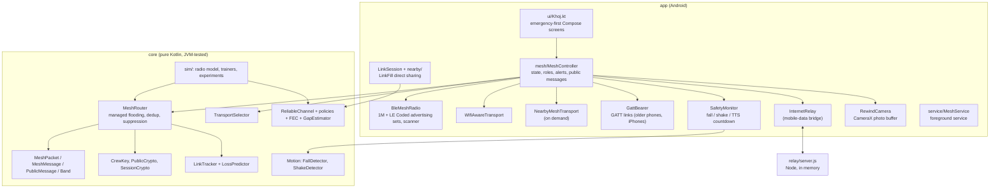

# KHOJ (engineering name: LinkFill AI)

> Finds your family in a crowd with no mobile network, and lets helpers and police reunite anyone, including a child or elder who carries no phone.

This README is the developer's guide: what is built, how each part works, **why** it was built that way, what was measured, and what is still unproven. A shorter user-level tour is in [docs/KHOJ_APP.md](docs/KHOJ_APP.md).

- **Stack:** Kotlin, Jetpack Compose, AndroidX CameraX, ZXing, Google Play services (Nearby, Location), a pure-Kotlin core module, a dependency-free Node relay.
- **Targets:** Android 10+ (minSdk 29, compile/target SDK 36). Developed and measured on an iQOO I2501 (Snapdragon SM8850, Android 16).
- **Size:** about 8,000 lines of Kotlin, 106 core JVM unit tests (0 failures), 1 relay test.
- **Package name:** `app.linkfill` (the project began as "LinkFill AI", a two-phone reliable-location experiment, and grew into KHOJ).

**Building the iPhone app on a Mac:** start with [docs/MAC_SETUP_IOS.md](docs/MAC_SETUP_IOS.md).

### What changed (Oct 2026 update)
- **Any crowded place.** KHOJ now works at stadiums, concerts, festivals, stations, religious gatherings and melas, not only the Kumbh. The old "pilgrim" role is now "member".
- **Two choices at setup.** Pick "With family or friends" (member) or "Helper". Helpers (volunteers, staff, security and police) share one screen. Police and officials also get signed official alerts after they scan the authority key QR in Settings.
- **SOS on a hold.** Holding SOS always works. It sounds a loud siren on the alarm stream at maximum volume (the old volume is restored afterwards), vibrates hard, starts the mesh if it is off, and sends a crew SOS and a public SOS. With no GPS fix yet, it sends "position unknown" and re-sends with the position once GPS finds one. A STOP SIREN button silences it. After an SOS, the phone stays at full power for 10 minutes. **Not yet tested on phones.**
- **Group circle.** The group picks 30, 50, 100 or 200 m in Settings (default 50). If a member leaves the circle, every phone vibrates and says "X left the group circle". A member out of radio range for 45 s also makes phones vibrate. **The rule is unit-tested; not yet tested on phones.**
- **Find Member has no switch.** Being in the group is consent. Precise ranging starts by itself within about 40 m. The person being found sees "X is finding you" with a "Pause for 30 minutes" button. **Not yet run between two phones.**
- **Urgent packets are carried.** Every phone keeps up to 32 urgent packets for 10 minutes and offers them to phones that arrive later. **Unit-tested.**
- **Battery saver.** Members can turn on battery saver in Settings, or it turns on at 15% battery when not charging. Beacons come every 15 s instead of 3. Helpers never use it. **Unit-tested.**
- **GATT links for older phones and iPhones.** Phones without Bluetooth 5 extended advertising no longer refuse to start. They join through GATT only. **Not yet tested on real phones.**
- **iOS.** No iOS app is built yet, because no Mac is available. The protocol is made iOS-compatible: AES-GCM tags are now 16 bytes, and shared test vectors are in `docs/interop/`. A Swift reference package is being written and is not compiled yet.
- **Back buttons** are now an arrow with the label "Back".
- **Tests:** 106 core JVM tests, 0 failures.

### Find Member (AirTag-style finding)
Tap **FIND** next to a crew member. The app uses the best source it actually has and says which:

| Tier | Source | Shows |
|---|---|---|
| Walking direction | Hardware distances measured while you walk an L (steps + compass + range fit) | Estimated arrow with a wedge; asks you to turn a corner when it cannot tell |
| Hardware ranging | Android 16 Ranging module (UWB, Bluetooth Channel Sounding, Wi-Fi RTT) over an authenticated tunnel | Real distance; a real arrow only if the hardware supplies an angle |
| GPS bearing | Both phones' fixes + true-north compass heading | Arrow with an uncertainty wedge, withheld when too close, too old or the compass is unreliable |
| Bluetooth proximity | Filtered signal strength of the target's own frames | Closeness bands, signal trend, haptic cue; **never an arrow** |
| Last known | Old position | Position and age only |

**Measured on the iQOO I2501:** UWB not supported, Bluetooth Channel Sounding enabled (distance only), Wi-Fi RTT not supported, so these phones can give a hardware **distance** but not a hardware **arrow**. Being in the group is consent, so there is no precise-finding switch. Precise ranging starts by itself within about 40 m, and the other person sees "X is finding you" with a "Pause for 30 minutes" button. No two-phone ranging session has been run yet. Docs: [architecture](docs/FIND_MEMBER_ARCHITECTURE.md) · [research](docs/FIND_MEMBER_RESEARCH.md) · [test plan](docs/FIND_MEMBER_TEST_PLAN.md).

---

## 1. Contents

1. [Problem and constraints](#2-problem-and-constraints)
2. [Architecture](#3-architecture)
3. [Features, how they work, and why](#4-features-how-they-work-and-why)
4. [Android platform notes](#5-android-platform-notes-things-that-bit-us)
5. [Measured device profile](#6-measured-device-profile-iqoo-sm8850)
6. [Simulation and experiments](#7-simulation-and-experiments)
7. [Testing](#8-testing)
8. [Build, run, configure](#9-build-run-configure)
9. [Security model](#10-security-model)
10. [Limitations, shortcuts and unverified claims](#11-limitations-shortcuts-and-unverified-claims)
11. [Decision log](#12-decision-log-why-the-design-changed)
12. [Extending the code](#13-extending-the-code)
13. [References](#14-references)

---

## 2. Problem and constraints

In crowded places such as stadiums, concerts, festivals, stations, religious gatherings and melas (for example the Kumbh), people get separated from family. Existing family-finder apps show a dot and need a network at the moment you are lost. Judges at an iQOO hackathon told us that "offline location sharing" is generic, so KHOJ is built around constraints that make the problem real.

| Constraint | Consequence for the design |
|---|---|
| **No mobile network** in a dense crowd | Everything must work over phone-to-phone radios. The mobile-data relay is an optional bridge, never required. |
| **Most people won't install the app** | Do not depend on strangers. Helpers (volunteers, staff, security, police) carry it as part of their duty and form the backbone; families install it before the event. |
| **Children and elders may carry no phone** | A printable wristband QR that any phone can scan; the "found" report reaches only that family. |
| **Android cannot make other phones relay** | Only phones running the app relay. No design can change this; we state it openly. |
| **Panicked users** | Emergency-first UI: one giant SOS, arrows instead of text, six languages. Automatic triggers (fall, shake) with a cancellable countdown. |
| **Privacy** | Family traffic is end-to-end encrypted; photos never leave the phone; public location is shared only when you ask for help. |
| **Hackathon honesty** | Every result says whether it was measured on a phone, unit-tested, or simulated with assumed parameters. |

---

## 3. Architecture



**Why a pure-Kotlin `core` module?** Everything that decides behaviour (routing, crypto, parsing, detectors, predictors) takes time as an argument and has no Android dependency. The same classes run in the phone, in the JVM unit tests and in the simulators, so the experiments measure the code that ships. Android code (`app/`) only moves bytes between radios and the core and draws screens.

**Threading model:** `MeshController`, `LinkSession`, `MeshRouter` and `ReliableChannel` are single-threaded and run on the main thread (Bluetooth, location and Nearby callbacks all arrive there; a 250 ms coroutine loop drives timers). No locks anywhere; the cost is that nothing heavy may run in them.

### Module map

| Path | Responsibility |
|---|---|
| `core/.../mesh/MeshPacket.kt` | 29-byte mesh header, packet types, crew `MeshMessage` codecs |
| `core/.../mesh/MeshRouter.kt` | Flooding, duplicate filter, relay delay and suppression, urgent resend, store-carry-forward, battery-saver friends, link-mode choice, public-message rate limit |
| `core/.../mesh/GattFraming.kt` | Splits mesh frames into GATT chunks (2-byte header) and joins them back |
| `core/.../find/Circle.kt` | Group circle rule with GPS error and 80% hysteresis |
| `core/.../mesh/CrewKey.kt` | 16-character crew code → AES-256-GCM key and public crew tag |
| `core/.../mesh/PublicMessages.kt` | Messages that cross crews (found reports, public SOS, respond, official, found notice) |
| `core/.../mesh/Band.kt` | Wristband QR format and the sealed `FoundReport` |
| `core/.../mesh/LinkTracker.kt`, `LossPredictor.kt` | Per-neighbour delivery ratio and RSSI features; logistic-regression loss predictor and metrics |
| `core/.../mesh/Transports.kt` | `TransportKind`, `TransportHealth`, `TransportSelector` |
| `core/.../security/PublicCrypto.kt` | P-256 key compression, ECIES seal/open, ECDSA sign/verify |
| `core/.../security/SessionCrypto.kt` | Direct-sharing key agreement (ECDH + HKDF), AES-GCM sealer |
| `core/.../estimate/Motion.kt` | `FallDetector`, `ShakeDetector` |
| `core/.../estimate/GapEstimator.kt` | Dead-reckoning estimate, distance and bearing helpers |
| `core/.../protocol/`, `reliability/`, `fec/`, `policy/` | LinkFill direct-sharing engine (see §4.10) |
| `core/.../sim/` | Radio model, link simulator, trainers, experiment runners |
| `core/.../tools/AuthorityKeys.kt` | Generates the police signing key and its QR |
| `app/.../mesh/` | `MeshController`, radios, transports, `GattBearer.kt`, `Siren.kt`, safety, Rewind |
| `app/.../ui/Khoj.kt` | The emergency-first UI; `Qr.kt` (QR render and scan); older LinkFill screens |
| `app/src/main/res/values*/` | Strings in en, hi, mr, te, bn, ta |
| `relay/` | `server.js`, `server.test.js`, README |

---

## 4. Features, how they work, and why

### 4.1 Emergency-first UI, setup and languages
**Files:** `ui/Khoj.kt`, `ui/Common.kt`, `res/values*/strings.xml`, `MainActivity.kt`

**What:**
- **First launch:** language → name and role ("With family or friends" or "Helper") → family group → permissions → start. After setup, KHOJ opens to the emergency screen and starts the mesh automatically.
- **Member home:**
  - a status strip;
  - alert banners with direction arrows;
  - a **hold-to-send SOS** (2 s, animated ring, long-press haptic);
  - "My family" with an arrow, distance and last-heard time per person;
  - the meeting point;
  - Found someone, Bands, Rewind and Settings buttons.
- **Helper home** (volunteers, staff, security, police): the SOS board with *I'm going*, scan wristband, found-without-band, and a signed-alert box for police and officials.
- **Countdown screen:** full-screen red, a large number and a huge *I'M OK* button.

**Why:**
- *Hold-to-send* avoids pocket bumps but needs no menus, and it is exposed to accessibility services as a single action.
- *Arrows instead of coordinates:* a panicked user cannot read latitude and longitude. The arrow is computed from the bearing to the target minus the phone's rotation-vector heading, using `GapEstimator.bearingDeg` and `Compass`.
- *Family joins by scanning a QR* (`KHOJ-CREW1:<code>`) instead of typing a 16-character code.
- *Role chosen once:* "With family or friends" (member) or Helper. Police and officials need one more step (scanning the authority key QR in Settings), so a Helper cannot self-promote to police.

**Languages:**
- All user-visible strings live in `values*/strings.xml` for English, Hindi, Marathi, Telugu, Bengali and Tamil. Compass words are a string-array so directions are local words.
- Android 13+ uses `LocaleManager.applicationLocales`. Older versions use the saved tag in `MainActivity.attachBaseContext`. `res/xml/locales_config.xml` registers the six locales in the system per-app-language picker.
- The spoken fall prompt (`SafetyMonitor`) uses the app locale, falling back to English if the phone has no voice for it.
- The engineering screens (Advanced, Diagnostics, LinkFill direct sharing) stay English by design.
- **The translations were drafted by an AI assistant and have not been reviewed by native speakers.**

### 4.2 The mesh: packets and managed flooding
**Files:** `core/.../mesh/MeshPacket.kt`, `MeshRouter.kt`; tests in `MeshTest.kt`

**Why a custom mesh instead of Nearby's multi-hop?** Nearby Connections links a device to a few peers and offers no application-level multi-hop routing. A broadcast mesh over BLE advertising needs no pairing, no connections, and works with any number of listeners.

**Packet (big-endian, ≤200 bytes so it fits a BLE extended advertisement or a LoRa/Meshtastic payload):**

```
'K' | version | type | flags | ttl | hops | linkSeq(2) | relayId(4) | crewId(4) | originId(4) | packetId(4) | originTime(4) | len | body
```

- **Link fields** (`ttl`, `hops`, `relayId`, `linkSeq`) change at every hop.
- **End-to-end fields** (`type`, `crewId`, `originId`, `packetId`, `originTime`) never change. Crew packets authenticate them as AES-GCM associated data.
- `packetId` is a per-run counter, and `originId` is a fresh random node id per run, so GCM nonces `(originId, packetId, crewId)` never repeat across restarts.
- **Flags:** bit `0x01` marks a frame from a battery-saver member (see `docs/MESH.md`).
- `MeshPacket.decode` returns null for anything malformed (bad magic, version, type, length, TTL > 8).

**Types:**

| Type | Sealed with | Purpose |
|---|---|---|
| `BEACON` | crew key | Position, accuracy, battery, name, and a "can be ranged" bit; every 3 s (every 15 s in battery saver) |
| `SOS`, `RALLY`, `TEXT`, `ACK` | crew key | Crew SOS, meeting point, 100-byte text, end-to-end acknowledgement |
| `NEIGHBOR` | none | Empty filler so neighbours can measure link quality when nothing else is sent. Battery-saver members send none. |
| `FOUND`, `FOUND_ACK`, `PUBLIC_SOS`, `RESPOND`, `OFFICIAL`, `FOUND_NOTICE` | see §4.6 | Cross-crew public messages |

**Routing (managed flooding):**
1. Every packet is recorded in a 2-minute `seen` map keyed by `(originId, packetId)`. Duplicates are dropped, and each duplicate is counted against any pending relay of the same packet.
2. A new packet is delivered locally if it is ours (crew match and authenticated) or public. Packets of **other crews are relayed but never read**.
3. If TTL remains, a relay is scheduled after `40 ms + strength × 400 ms + random(0..250 ms)`, where `strength` is the received RSSI mapped to 0..1. Phones that heard it **weakly** are probably far from the last sender, so they relay **first**, pushing it further.
4. **Suppression:** a pending relay is cancelled if 2 *other* relays of the same packet were heard before it fired. In the range simulation, turning suppression off tripled transmissions and reduced reach through collisions.
5. A crew packet that claims our crew tag but fails authentication is **neither delivered nor relayed** (forged or corrupt).
6. The originator re-sends SOS, RALLY, FOUND and PUBLIC_SOS every 10 s, up to 6 times, until an end-to-end `ACK` or a responder replies. Resends **reuse the original ciphertext**: an earlier version re-sealed with a new timestamp under the same nonce, which would have broken AES-GCM, so this was fixed and is tested.
7. Packets older than 10 minutes, or more than 60 s in the future, are dropped. The queue is bounded at 64 entries (relays are dropped first).
8. **Store-carry-forward (packet healing):** the originator stops after 6 tries, so a phone that arrives after that never hears the packet. So every phone also keeps up to 32 urgent packets (SOS, ACK, RALLY, PUBLIC_SOS, RESPOND, FOUND, FOUND_ACK, OFFICIAL) for their 10-minute life. When a phone it has not heard for 60 s appears, it offers up to 8 of the newest. Offers are relays, so carriers suppress each other, and duplicates are dropped. Carried packets stay in the duplicate cache for their whole life. Unit-tested: a late arrival receives an SOS exactly once, and re-offers never deliver twice.
9. Mesh packets are single frames. The Reed-Solomon FEC and `ReliableChannel` are used only in direct sharing (§4.10), not in the mesh.

**Configuration:** `MeshConfig` (default TTL 6, repeat interval 10 s, relay timing, suppression threshold, memory windows).

### 4.3 Crew and key management
**File:** `CrewKey.kt`

- A crew is a 16-character code from a 32-letter alphabet without `0/O/1/I` (80 bits of entropy). Shown as `ABCD-EFGH-JKLM-NPQR`, shared in person or by QR.
- `HKDF(salt="KHOJ crew v1", ikm=code)` yields the AES-256 key plus a public 32-bit `crewId` tag used for filtering.
- **Why a shared static key?** It needs no server, no pairing and no key exchange between family members who are physically together at setup. It is enough for a family or group. The trade-offs (no forward secrecy, no member removal, the tag links packets of the same crew) are listed in §11.

### 4.4 Many radios behind one mesh
**Files:** `BleMeshRadio.kt`, `WifiAwareTransport.kt`, `NearbyMeshTransport.kt`, `InternetRelay.kt`, `core/.../Transports.kt`, `MeshController.kt`

Inspired by how Google Nearby Connections hides Bluetooth and Wi-Fi behind one API, and by the observation that no single radio is right everywhere.

| Radio | Mechanism | Role |
|---|---|---|
| **Bluetooth LE** (always on) | Non-connectable **extended advertising** to send, filtered scan to receive. Two advertising sets run **at the same time** where the chip supports it: LE 1M (everyone hears it) and **LE Coded** (about 4× range per the Bluetooth SIG, only Coded-capable phones hear it). Interval 100 ms, TX power MAX (+1 dBm exposed to apps). | Discovery, link measurement, the base carrier |
| **Wi-Fi Aware** | Publish + subscribe; frames go as acknowledged messages to each discovered peer. The send callbacks are Wi-Fi's own ACKs, so link quality is measured directly. | Higher-rate local link where the phone supports it (the iQOO does not) |
| **Nearby (cluster)** | Up to 4 auto-accepted connections; Google picks Bluetooth or Wi-Fi underneath. | Stronger local link on demand |
| **GATT bearer** | Every phone runs a GATT server plus a legacy connectable "door" advert. Links open only when one side lacks extended advertising (older phones) or is an iPhone. Max 4 links. Frames are split by core `GattFraming` (2-byte header). | Cross-platform path for older phones and iPhones (`GattBearer.kt`) |
| **Mobile-data relay** | Upload to / long-poll `relay/server.js`. | Bridge between distant groups wherever any phone has signal |

Phones without Bluetooth 5 extended advertising no longer refuse to start. They join through GATT only. Nearby Connections on iOS has no Bluetooth path to Android, and Multipeer is Apple-only, so GATT is the cross-platform channel. **The GATT bearer is not yet tested on real phones.** Its spec is in [docs/GATT_BEARER.md](docs/GATT_BEARER.md), and the research is in [docs/CROSS_PLATFORM_RESEARCH.md](docs/CROSS_PLATFORM_RESEARCH.md).


**`TransportSelector`** decides which local radios carry each frame. Mobile data is excluded: it is a bridge, not a per-frame choice.
- Mode **AUTO** (default): Bluetooth always. Add the best other link when Bluetooth's measured delivery is below 80% or the other link is better. Use **every** usable link for SOS, ACK, RALLY, official, found and found-ack messages, or when predicted risk ≥ 0.6.
- Modes **BEST_ONLY** and **ALL** are available in the Advanced screen.
- Each radio's quality is its measured delivery: Bluetooth uses the median neighbour packet-delivery ratio (because advertising has no ACK), and the others use Laplace-smoothed recent success counts.
- The router's duplicate filter makes sending the same packet on several radios safe.

**Internet bridge (`MeshRouter.bridge`):** a phone with data uploads every packet it **originates**, and every packet it **first hears** on a local radio, regardless of local relay suppression. This matters: in dense crowds suppression cancels most relays, so the first design (upload only when relaying) rarely fired. Simulation at 1% adoption: far-end reach 37% → 100% after the fix. Phones with data download the crew's packets and re-broadcast them locally.

**Adaptive power (from measurements on the iQOO, §6):**
- Nearby runs **on demand** only: when Bluetooth already hears neighbours and an SOS, a risky link, or "ALL" mode needs it, then for 60 s. Helpers keep it on. Always-on Nearby cost about 3× the Bluetooth stack's CPU.
- The scanner is `LOW_LATENCY` while neighbours were heard in the last 60 s, something urgent is pending, or in the first minute; otherwise it drops to a power-saving mode. Android blocks apps that restart scans more than 5 times in 30 s, so switches are limited to one per 30 s.

### 4.5 Link tracking, loss prediction and adaptation
**Files:** `LinkTracker.kt`, `LossPredictor.kt`, `MeshRouter.updateMode`, `sim/TrainLinkModel.kt`

This implements the recommendations of the research brief in `Downloads/Predicting and Recovering Bluetooth Packet Loss at Long Range.md`, within what an Android app can see.

- **Delivery ratio without ACKs:** every node sends one frame per 250 ms slot with an incrementing 16-bit `linkSeq`. Battery-saver members send far less often (see `docs/MESH.md`). The gaps in a neighbour's `linkSeq` give its packet delivery ratio (PDR) directly. RSSI exists only for frames that arrived (survivorship bias near the edge), which is why PDR history is tracked alongside it.
- **13 features** per neighbour: distance (simulation only), RSSI median, minimum, spread, slope and recent drop, PDR over 0.5, 2 and 10 s, consecutive misses, time since last frame, LE Coded flag, and queue depth.
- **Predictor:** logistic regression (L2 1e-3, 400 gradient steps) for "fewer than 2 of the ~2 expected frames arrive in the next 0.6 s". It is deliberately simple (as the brief recommends first): easy to debug, cheap on a phone, with checkable calibration. Evaluation uses **held-out routes**, not random rows, to avoid leakage between adjacent samples.
- **Adaptation:** the median neighbour risk picks a mode: `NORMAL` (1 repeat), `MEDIUM` (risk ≥ 0.3, 2 repeats), `HIGH` (risk ≥ 0.6, 3 repeats, and long range if supported). Step-up is immediate, step-down needs 10 s of lower risk (hysteresis). With no neighbours the risk is treated as 1.0 (reach further). Since the radio now keeps 1M and Coded sets running permanently, the mode's PHY part is informational; its repeat count still matters.
- **Real-data loop:** `MeshController.sampleLinks` writes the same features, labelled 5 s later, to `link_log.csv` in the app's files directory (`adb pull`), so the simulated model can be retrained on real phones.

### 4.6 Wristbands, volunteers, police and public messages
**Files:** `Band.kt`, `PublicMessages.kt`, `PublicCrypto.kt`, `MeshController.kt`, `Qr.kt`

**Wristband.** The family phone creates a band: a fresh P-256 key pair is generated; the **public key** (compressed, 33 bytes), name, age, phone number, meeting point and the family's `crewId` go into a QR `KHOJ-BAND1:<base64url>`. The private key stays in that phone. The printable PNG (`saveBandImage`) shows the QR plus large readable text, so a finder **without** the app can still call the number. QR error correction is level M so a creased band still scans.

**Found report (the core cross-crew flow):**
1. A volunteer scans the band (ZXing on the CameraX luminance plane, fully offline).
2. The app builds a `FoundReport` (volunteer location, desk name, note) and **ECIES-seals it to the band's public key**: ephemeral ECDH, HKDF, AES-256-GCM, with `crewId ‖ bandId` as associated data so a report cannot be replayed against another band.
3. It goes out as a `FOUND` public packet and repeats every 10 s up to 6 times until a `FOUND_ACK` arrives. Relays see only ciphertext. Phones that carry urgent packets hold it too (§4.2).
4. The family phone finds the matching band, decrypts, shows "Riya has been found" with an arrow, notifies, sends the `FOUND_ACK`, and tells the rest of the crew via a crew text, because other members don't hold the band's private key.

**Why public-key sealing?** The volunteer and the family share no secret. This lets anyone report, but only that family read the report, with no server.

**Roles.**
- *Member (with family or friends):* the default. Needs a crew.
- *Helper (volunteers, staff, security, police):* no crew needed; Nearby and fast scanning stay on, because their phone is part of the backbone. They see the SOS board.
- *Police and officials:* the Helper screen, plus signed official alerts. The key QR is scanned in Settings. `unlockPolice` accepts a QR `KHOJ-POLICE1:<PKCS8>` only if the private key matches the **authority public key bundled in the app** (it signs and verifies a test message). The key pair is generated by `./gradlew :core:makeAuthorityKey`, with the private half and the QR in `secrets/` (git-ignored).

**Public message types.**

| Type | Content | Trust |
|---|---|---|
| `FOUND` / `FOUND_ACK` | ECIES-sealed report / receipt id | Only the band's family can read |
| `PUBLIC_SOS` | kind (manual, fall, panic, lost), location, name | Unauthenticated by design: anyone may ask for help. Rate-limited. |
| `RESPOND` | which SOS, role, name | Shown to the person asking and to other responders |
| `OFFICIAL` | text ≤ 80 bytes + ECDSA signature | Verified against the bundled authority key; **forgeries are dropped silently** |
| `FOUND_NOTICE` | location + free-text description of someone found with no band | Shown to every phone nearby |

**Rate limit:** at most 5 public packets per 10 s per origin, enforced at every relay, so one phone cannot flood Helpers' screens (tested).

### 4.7 The SOS flow
`sendSos(kind)` in `MeshController`:
1. Holding SOS (2 s) always works. The phone plays a loud rising and falling siren on the alarm stream at maximum alarm volume (the previous volume is restored afterwards), vibrates hard, and starts the mesh if it is off. A large STOP SIREN button appears. Crew phones that receive the SOS vibrate hard too. The alarm is in `mesh/Siren.kt`.
2. If the phone has a crew, send a crew `SOS` (encrypted: location + "name: reason"). Notified crew members acknowledge end to end, and the sender sees who received it.
3. Always send a `PUBLIC_SOS` (kind, location, name) so Helpers and police nearby see it on their board with distance and direction.
4. With no GPS fix yet, the SOS goes out as "position unknown" (0,0). It re-sends automatically with the position once GPS finds one.
5. Both repeat until acknowledged or a responder replies. The phone stays at full power for 10 minutes after an SOS.
6. Responders tap *I'm going*, which sends `RESPOND`. The person who asked sees "Help is coming: Volunteer Ravi is on the way", and the repeats stop.
7. `applyTransports()` runs immediately, so Nearby and fast scanning start without waiting for the 5-second tick.

The siren, the vibration, the no-fix resend and the 10-minute full power are **not yet tested on phones**.

### 4.8 Pendant safety: fall, panic, Rewind
**Files:** `Motion.kt`, `SafetyMonitor.kt`, `RewindCamera.kt`, `MeshService.kt`

**Why a pendant?** An elder or a member in water is not holding a phone. A waterproof pendant puts the phone on the chest with the rear camera facing forward.

- **`FallDetector`** (accelerometer magnitude, about 50 Hz): free fall below 0.45 g for at least 60 ms, then an impact above 2.2 g within 800 ms, then 2 s of stillness (standard deviation under 1.2 m/s²). Each stage happens in daily life; the sequence rarely does.
- **`ShakeDetector`:** 4 peaks above 2.5 g within 2 s (at least 150 ms apart) as a panic gesture. **Volume keys were rejected:** Android doesn't let apps read hardware keys while backgrounded.
- **`SafetyMonitor`:** a detection starts a 10 s countdown: vibration, a spoken prompt in the app language (twice), a full-screen *I'M OK* button, and a "Cancel SOS" action in the notification. Only if it expires does it call `sendSos`. This countdown is the guard against false alarms.
- **`RewindCamera`** (CameraX `ImageCapture`, a private `LifecycleOwner` so it works without an Activity): a photo every 3 s, downscaled (JPEG sample size 8, quality 70), kept **3 minutes in memory only** with time and GPS, never written to storage or sent. It pauses while the QR scanner needs the camera and is erased when the mesh stops. A crew member silent for 45 s raises "Lost contact" with a link to Rewind.
- **Foreground service types:** `MeshService` runs as `location|connectedDevice`, and adds `camera` **only while Rewind is actually running with the camera permission** (Android crashes the service otherwise). The notification is the visible indicator and carries a Stop button.

### 4.9 Position, direction and gap estimation
- `LocationProvider`: fused location at 1 Hz, high accuracy (GPS works without mobile data).
- `Compass`: rotation-vector sensor → heading.
- `GapEstimator`: constant-velocity dead reckoning from the last fix, with uncertainty growing at 1.5 m/s, withdrawn beyond 50 m or 60 s. It is deterministic and **not machine learning**; it is used only in LinkFill direct sharing and always labelled "estimated".

- **Group circle** (`core/.../find/Circle.kt`): the group picks 30, 50, 100 or 200 m in Settings (default 50). A member is outside when their distance, minus both GPS accuracies, is more than the radius. Then every phone vibrates and notifies "X left the group circle". The member counts as back inside below 80% of the radius (hysteresis). A member out of radio range for 45 s also makes phones vibrate. The rule is unit-tested; not yet tested on phones.

### 4.10 LinkFill direct sharing (the original engineering mode)
**Files:** `core/.../protocol`, `reliability`, `fec`, `policy`, `security/SessionCrypto.kt`, `app/.../session`, `nearby`, Sender/Receiver/Diagnostics screens. Reachable from **Settings → Advanced**.

Two phones, Google Nearby `P2P_POINT_TO_POINT`, confirm the same authentication digits on both screens, then share location. On top of Nearby it implements its own reliability layer, because the Bluetooth controller never exposes dropped radio frames to apps.

- **Wire format:** a 47-byte header (magic, version, type, flags, session id, sender id, sequence, message id, created, expires, body length) with the body sealed by AES-256-GCM; **the whole header is associated data**. Decode rejects malformed, oversized, expired (10-minute TTL cap, 5 s clock skew) and wrong-session messages.
- **Handshake:** ephemeral ECDH P-256 + HKDF, with the Nearby authentication digits mixed into the key derivation (a man-in-the-middle with different digits gets different keys). One AES key per direction. A reconnect within 2 minutes proves possession of the previous session's keys with an HMAC, so no re-pairing.
- **`ReliableChannel`:** sequence numbers, ACKs (batched), RFC 6298 RTO (SRTT + 4·RTTVAR, only from first transmissions), exponential backoff with jitter, max 4 attempts, latest-location-wins, 5 s location expiry, no stale backlog after reconnect. The receiver tracks gaps with a 64-entry `ReplayWindow`, rejects duplicates (re-ACKing them, since the ACK may be what was lost), sends recovery requests (NACKs), and learns from sender heartbeats which gaps are "settled".
- **Redundancy:** when the policy says so, later updates carry copies of the last unacknowledged fixes.
- **Reed-Solomon:** systematic code over GF(2⁸) with a Cauchy parity matrix; the demo sends a 4 KB payload as 10 data + 4 parity chunks once, with no retransmission, and verifies SHA-256.
- **`RecoveryPolicy`:** when a location update times out, choose `RETRY_NOW`, `WAIT_RETRY`, `ADD_REDUNDANCY` or `MARK_STALE`. There are three implementations:
  - fixed baselines;
  - `DeterministicRecoveryPolicy` (hand-written rules);
  - `MlRecoveryPolicy`, an MLP (10 inputs, 24 tanh units, 4 outputs) that predicts each action's cost and picks the cheapest. Its **reject option** (after Chow's rule, as used in the BLE neural error-correction paper) falls back to the rules when the top two costs are within 0.05 s or the input is far outside the training data.
- **Why no neural BLE error correction?** The cited paper (Almeida et al., *Sensors* 2025) corrects bit errors from received signal samples in simulation. An Android app never sees packets that fail the CRC. We took the reject option from it and nothing else; see [docs/RESEARCH.md](docs/RESEARCH.md).

---

## 5. Android platform notes (things that bit us)

| Topic | What we learned | Where handled |
|---|---|---|
| Wi-Fi permissions | Google's Nearby page caps `ACCESS_WIFI_STATE` / `CHANGE_WIFI_STATE` at API 31, but on Android 16 Nearby reported "missing permission access wifi state". They are auto-granted normal permissions, so the manifest declares them uncapped. | `AndroidManifest.xml` |
| Compose / AGP | The newest Compose BOM (2026.09) needs compile SDK 37 and AGP 9.1. We pinned BOM 2026.05.01 with SDK 36 and AGP 8.13.2. | `gradle/libs.versions.toml` |
| TX power | The controller supports Power Class 1 (up to +20 dBm), but Android exposes at most +1 dBm to apps. There is no hidden range to unlock. | `BleMeshRadio` |
| Scan restarts | Apps that start scans too often get throttled. Scan mode switches are limited to one per 30 s. | `BleMeshRadio.setLowLatencyScan` |
| Background scanning | A scan filter is required for scanning to continue with the screen off; ours (service-data UUID) is offloaded to the controller (64 filters available). | `BleMeshRadio.scanFilter` |
| Advertising sets | Extended advertising sets are cheap (16 supported on the iQOO). Switching PHY by stopping and restarting a set loses frames, so we keep 1M and Coded running together. | `BleMeshRadio.Advertiser` |
| Foreground service types | `camera` type needs the runtime camera permission; adding it unconditionally crashes the service. It is added only while Rewind runs. | `MeshService`, `MeshController.refreshService` |
| Hardware keys | Apps can't read volume keys in the background, so the panic trigger is a shake. | `ShakeDetector` |
| Nearby clients | Direct sharing and the mesh's Nearby transport share one client, so the mesh pauses its Nearby radio during direct sharing. | `MeshController.applyTransports` |
| Battery management | OriginOS-style managers may pause a background mesh. The app offers the system "run unrestricted" dialog; the choice is the user's. | `MeshController.batteryUnrestricted`, Advanced screen |
| Cleartext | HTTP is allowed so a laptop relay works on a LAN in demos. Mesh packets are already encrypted. | Manifest |
| Locale | Per-app language on 13+ via `LocaleManager`; before that via `attachBaseContext`. | `MainActivity`, `Khoj.kt` |
| No extended advertising | Phones without Bluetooth 5 extended advertising join through GATT only, instead of refusing to start | `GattBearer.kt`, `BleMeshRadio` |

---

## 6. Measured device profile (iQOO SM8850)

Full detail: [docs/DEVICE_PROFILE_IQOO.md](docs/DEVICE_PROFILE_IQOO.md). Captured with `adb shell dumpsys bluetooth_manager`, `pm list features`, `top`, and the app's own `KHOJ` log line.

- **Controller:** Bluetooth 6.0; LE Coded, LE 2M, extended and periodic advertising supported; 1,650-byte advertisements; 16 advertising sets; 64 offloaded scan filters; Channel Sounding present.
- **Wi-Fi:** Wi-Fi Direct yes; **Wi-Fi Aware no; Wi-Fi RTT no.**
- **Our radio state:** two sets (1M and Coded), each at +1 dBm, 100 ms interval, 0 advertise errors.
- **CPU (one phone, no peers):** Bluetooth process about 10% with Nearby always on, about 3% without; app about 1%.

These numbers drove the "Nearby on demand" and "adaptive scanning" changes. **Range between phones has not been measured yet** (it needs two or more phones).

---

## 7. Simulation and experiments

All experiments run the real core code over a modelled radio. **Radio parameters are assumptions, not measurements**; use the results to compare designs and adoption levels, then measure on phones.

| Command | What it does | Output |
|---|---|---|
| `./gradlew :core:trainPolicy` | 400 simulated Gilbert-Elliott links with random actions; trains the recovery-policy MLP | `.../recovery_policy_v1.mlp` (bundled) |
| `./gradlew :core:runExperiment` | 5 strategies × 4 link scenarios × 20 held-out runs, plus a bulk FEC experiment | [docs/RESULTS.md](docs/RESULTS.md) |
| `./gradlew :core:trainLinkModel` | 400 simulated routes, 30% held out by route; ablations on distance, RSSI, PDR, combined and full feature sets | model + [docs/LINK_PREDICTOR_RESULTS.md](docs/LINK_PREDICTOR_RESULTS.md) |
| `./gradlew :core:runMeshRange` | A 2 km × 200 m strip, 1 person/m², flood one message at several app-adoption levels, radios and bridge settings | [docs/MESH_RANGE_RESULTS.md](docs/MESH_RANGE_RESULTS.md) |
| `./gradlew :core:makeAuthorityKey` | Police key pair | `authority_public.txt`; `secrets/` |

**Key results (simulation):**

- **Loss predictor** (held-out routes, target "loss in next 0.6 s", base rate 30%): PR-AUC **0.47** distance-only, 0.69 RSSI-only, 0.81 delivery-history-only, 0.82 RSSI + history, **0.83** full; recall at a 10% false-alarm rate 25% → 73%. For "neighbour lost for 5 s" (base rate 5%): 0.14 → 0.59. As the brief predicted, delivery history beats RSSI, and RSSI beats distance. Calibration gap ≤ 0.10 in bins with 50+ samples.
- **Mesh range** (0.25% of people run KHOJ): 1M Bluetooth stops near 1 km; + Wi-Fi Aware reaches about 48% of app phones at 1–1.5 km; + the data relay with 10% of app phones online reaches **100% at 2 km** in about 2.3 s. Relay suppression off: about 3× transmissions, lower reach.
- **ML recovery policy** (harsh bursty link): mean position age 0.83 s against 1.02 s for plain retry (p95 2.0 s against 2.9 s) at about 20% more bytes. Validation MSE is 0.596 against 0.610 for the per-action-mean baseline: the model's edge is **modest**, since most of the cost is random future channel behaviour. On a clean link all strategies are equal.

---

## 8. Testing

```bash
./gradlew :core:test       # 106 JVM tests, 0 failures
cd relay && node --test    # relay: store, long-poll, crew filter, size limit
```

| Suite | Covers |
|---|---|
| `ProtocolTest` | Envelope round trip, malformed / oversize / bad-magic / wrong-version / unknown-type, expiry and clock skew, payload validation |
| `ReliableChannelTest` | Delivery, dedup + re-ACK, lost-ACK retransmit, bounded retries, backoff bounds, expiry, supersede, gap + NACK recovery, redundancy recovery, wrong session/key, tampered header, reliable stop, policy features, replay window |
| `FecAndPolicyTest` | GF(256), Reed-Solomon from any *k* shards (200 random cases), rules, ML policy and abstention, model file errors, gap estimator, ECDH key agreement |
| `MeshTest` | Packet and message round trips, crew code and sealing, chain hopping through non-crew relays, TTL, SOS repeat and ACK, suppression, forged packets, bridge-once, link tracker, predictor learning and serialisation, metrics |
| `TransportSelectorTest` | Selection by quality/risk/urgency, combined-delivery estimate |
| `SafetyTest` | Key compression, ECIES, signed alerts, band QR (incl. decoding with a stock ZXing reader), end-to-end found-report relay with ciphertext-only relays, public SOS + rate limit, fall and shake detectors on synthetic motion |
| `GroupSafetyTest` | Group circle rule and hysteresis, SOS reaching a member who arrives later, re-offers never delivered twice, battery-saver member does not relay and a friend fills in, GATT framing at every MTU, low-power flag is link-level only |
| `RangeBearingTest` | Walking-direction fit on synthetic walks (see [FIND_MEMBER_TEST_PLAN](docs/FIND_MEMBER_TEST_PLAN.md)) |
| `InteropVectorsTest` | Cross-platform test vectors in `docs/interop/khoj_test_vectors.json` |

**What is *not* covered by automated tests:** anything touching real radios, camera, location, Compose UI, `MeshController`, foreground services and translations. Those are checked by hand on the phone, and the status table (§11) says exactly which.

Manual two-phone procedures: [docs/TESTING.md](docs/TESTING.md) (direct sharing) and [docs/SAFETY.md](docs/SAFETY.md) (KHOJ flows).

---

## 9. Build, run, configure

Requirements: JDK 17+ (Android Studio's JBR works), Android SDK 36, Node 18+ (relay only), Android 10+ phones with Google Play services. Bluetooth 5 extended advertising is best, but phones without it join through GATT.

```bash
./gradlew :app:assembleDebug
adb install -r app/build/outputs/apk/debug/app-debug.apk
node relay/server.js 8787      # optional bridge; see relay/README.md
```

**Configuration:**
- **Relay URL:** Settings → Advanced → Crew Mesh → Radios → *Relay server URL*, for example `http://<laptop-LAN-IP>:8787`.
- **Crew code:** created in setup. The family QR is under Settings.
- **Group circle and battery saver:** both are in Settings. The circle size is 30, 50, 100 or 200 m (default 50).
- **Police unlock:** open `secrets/authority_police_qr.png` on a laptop, then scan it in Settings.
- **Logs:** `adb logcat -s KHOJ` prints the capability line at start. `link_log.csv` sits in `Android/data/app.linkfill/files/`.

**Gotchas for contributors:**
- Rebuild the app after `makeAuthorityKey`; the public key is a bundled resource.
- Under Git Bash on Windows, set `MSYS_NO_PATHCONV=1` for `adb` paths such as `/sdcard/...`.
- Don't commit `secrets/` or `local.properties` (both are git-ignored).

---

## 10. Security model

| Asset | Protection | Residual risk |
|---|---|---|
| Crew traffic (positions, SOS, text) | AES-256-GCM under the crew key; end-to-end fields authenticated | Anyone who learns the crew code can read the crew's traffic; no forward secrecy or member removal |
| Found reports | ECIES (ECDH P-256 + HKDF + AES-GCM), bound to crew and band | Whoever scans a band can *send* a report (that is the purpose); only the family can read it |
| Official alerts | ECDSA P-256 against a bundled authority key | If the private key (QR) leaks, anyone can send "official" alerts |
| Public SOS | Unauthenticated by design; per-sender rate limit (5 / 10 s) | A rogue phone can create fake SOS entries (limited rate) |
| Rewind photos | In memory, 3 minutes, erased on stop, never sent | The pendant's camera records bystanders, and the user must be told (notification) |
| Location | Crew sees it; public only on SOS | Packets carry a public crew tag, so observers can link traffic of the same crew |
| Direct sharing | Nearby digits confirmed by users and mixed into the key derivation | Needs both users to compare the digits |
| Relay server | Sees only encrypted packets and headers | No authentication; anyone knowing a crew tag can read or add ciphertext |
| Precise finding (Find Member) | Crew members only. Ranging starts by itself within about 40 m; the person found sees a notice and can pause for 30 minutes | Anyone in the group can range you when close, without asking. Being in the group is the consent. |

Packets are validated before use everywhere (codecs return null/rejected, never throw on network input), and nothing sensitive is logged.

---

## 11. Limitations, shortcuts and unverified claims

**Status of each area**

| Area | Status |
|---|---|
| Emergency UI, setup, language switching, family QR, SOS screen | **Verified on an iQOO** (Hindi and English screens, QR step) |
| Wristband QR + printable image | **Verified on an iQOO**; QR decodes with a stock reader (unit test) |
| Pendant mode, Rewind capture in the background | **Verified on an iQOO** (camera foreground service; 11 → 23 photos in 30 s) |
| Mesh radio on two PHYs, adaptive scan, Nearby on demand | **Running and measured on one iQOO**, with no peers |
| Siren, vibration, STOP SIREN, full power after an SOS | Written; **not yet tested on phones** |
| Group circle | Rule **unit-tested**; **not yet tested on phones** |
| Store-carry-forward, battery-saver members | **Unit-tested**; no phone run |
| GATT bearer (older phones, iPhones) | Framing **unit-tested**; **not yet tested on real phones** |
| Automatic precise-ranging start (within about 40 m), Channel Sounding ranging | Written; **not yet run between two phones** |
| Fall and shake detectors | Unit-tested on synthetic motion only; **never physically dropped or shaken** |
| Found report, SOS board, *I'm going*, official alerts, found notices | Unit-tested through a simulated mesh; **no two-phone run yet** |
| Multi-hop on real phones, real range, LE Coded vs 1M | **Not measured** |
| Mobile-data relay with real phones | Server tested; **no phone-to-server field run** |
| Wi-Fi Aware transport | Written, **unrunnable on the iQOO** (no hardware), untested anywhere |
| Link predictor, ML policy, range | **Simulation with assumed parameters** |
| Translations | Drafted by AI; **unreviewed** |

**Known shortcuts (marked in code):**
- **Key storage:** the crew code, band private keys and police key sit in app-private `SharedPreferences`. They should move to the Android Keystore.
- **Static crew key:** no rotation, forward secrecy or member removal.
- **Relay:** no authentication; the HTTP allowance is for demos.
- **Public messages through the relay:** public SOS packets use crew tag 0, so only phones polling tag 0 (volunteers without a crew) receive them over the relay. Found reports use the band's family tag and are not affected. Over local radios, all of them propagate normally.
- **Role plumbing:** the permission flow reuses `Role.NONE` as "open the mesh" in `MainActivity`; harmless, but worth cleaning up.
- **Rewind** is time and place only: no person detection in the frames.
- **Low battery:** the battery level is in every beacon, and battery-saver members beacon every 15 s, but no last-gasp beacon is sent.

**Not built:** Snan Guard (water-dip detection via barometer, light and motion through the pouch), a crowd-density map from Bluetooth counts, a LoRa transport (the packet format was designed for it), an iOS app (no Mac available yet), and Keystore storage.

**Honest framing:**
- Offline location sharing and Bluetooth mesh apps already exist (BUDDY, Bridgefy and others). What KHOJ adds is the combination aimed at crowded events such as the Kumbh: no-phone wristbands with family-only found reports, signed police alerts, a pendant that detects falls and records for Rewind, six languages, and measured link adaptation. It does not claim to beat every existing solution.
- No app can make non-app phones relay, and nothing here can locate a person with no wristband and no phone.

---

## 12. Decision log (why the design changed)

| Decision | Why |
|---|---|
| Started as LinkFill: direct two-phone sharing with a reliability layer | The brief: demo offline location over Nearby, with an honest recovery layer and no claim of rebuilding radio packets |
| **Dropped** ideas that depended on strangers' apps (voiceprint search by the crowd, crowd sightings, finder photo matching) | Judges and the team: don't depend on people having the app; microphones in a noisy crowd don't work |
| **Dropped** acoustic ranging, haptic direction, barometric floor lock, Sound Radio, a help-desk console in Office Kit | Noisy places; the screen can show direction; distances of hundreds of metres; forced fit |
| Built a **custom BLE advertising mesh** | Nearby is one-to-few and gives no app-level multi-hop; advertising needs no pairing |
| Inspiration from the beacon/RNDVU repo | It uses **Meshtastic LoRa radios**, not Bluetooth, for range. We took typed messages, crew filtering and simulation-first testing; our packets fit LoRa too |
| Added the predictor, adaptive link mode and ablations | The research brief: loss is predictable from delivery history; distance alone isn't enough |
| **Multi-radio selector + internet bridge** | Request to combine radios like Nearby does; the simulator showed reach needs the bridge to upload regardless of suppression |
| Nearby on demand, adaptive scan, dual-PHY advertising | Measured CPU on the iQOO; PHY switching lost frames |
| Wristband QR with family-only sealed reports; volunteer and police roles | The judges' feedback: edge cases (no phone, no app), police and volunteers should use it |
| Pendant: fall, shake, Rewind | Waterproof pendant on hand; elders can't operate a phone; "where did you last see her?" |
| Emergency-first UI, six languages | Simple to use in an emergency; multilingual users |
| One Helper role with one screen; police add signed alerts after a key scan | Volunteers, staff and security need the same tools; only police need signed alerts |
| Removed the precise-finding switch; ranging starts within about 40 m | Being in the group is consent. The person found still sees a notice and can pause |
| Store-carry-forward for urgent packets | The originator's repeats stop after 6 tries, so a phone that arrives later missed the SOS |
| GATT bearer for older phones and iPhones | Nearby and Multipeer cannot link Android and iOS; GATT is the cross-platform channel |
| Battery saver for members | Members at low battery send less often; helpers stay on full power as the backbone |

---

## 13. Extending the code

- **Add a mesh message:** add a `MeshType` code and a data class in `MeshMessage` (crew-sealed) or `PublicMessage` (cross-crew), implement encode/decode with validation, handle it in `MeshController.onMessage`/`onPublic`, and add a round-trip and malformed-input test.
- **Add a radio:** implement a class like `NearbyMeshTransport` with a `TransportHealth`; add a `TransportKind`; feed received bytes to `MeshController.onOtherFrame`; add it to `transmit()`/`applyTransports()`. For LoRa, the 200-byte packet already fits.
- **Retrain on real data:** `adb pull .../link_log.csv`, then load it with the same feature order (`LinkFeatures.ALL`) into `LossPredictor.train`, and replace `loss_predictor_v1.txt`. Keep a held-out split by route.
- **Add a language:** copy `values/strings.xml` to `values-xx/`, translate all keys including `compass`, and add the tag to `LANGUAGES` in `Khoj.kt` and `res/xml/locales_config.xml`.
- **Change detector thresholds:** `FallDetector` and `ShakeDetector` take constructor parameters; adjust with tests on recorded motion.

---

## 14. References

- Almeida et al., *Error Correction in Bluetooth Low Energy via Neural Network with Reject Option*, Sensors 25(19):6191, 2025. We use only the reject-option idea. [docs/RESEARCH.md](docs/RESEARCH.md).
- Research brief *Predicting and Recovering Bluetooth Packet Loss at Long Range*. The source for the sequence-number loss measurement, PDR-first features, held-out evaluation and ablations.
- Gilbert–Elliott burst-loss model (used in the simulators).
- Tsimbalo, Fafoutis et al., application-layer redundancy for connectionless BLE. Motivation for redundancy and FEC.
- Google Nearby Connections and Android Bluetooth LE, Wi-Fi Aware and location documentation.
- Bluetooth Mesh specification: the proxy (GATT) and low-power node ideas. KHOJ adapts them; it is not a Bluetooth Mesh implementation.
- Koester, lost-person behaviour. Early KHOJ search-planning ideas; not part of the shipped app.
- `github.com/Charrlllezz/beacon` (RNDVU): the Meshtastic-based festival crew app we studied.
- Related docs: [KHOJ_APP](docs/KHOJ_APP.md), [SAFETY](docs/SAFETY.md), [MESH](docs/MESH.md), [DEVICE_PROFILE_IQOO](docs/DEVICE_PROFILE_IQOO.md), [ARCHITECTURE](docs/ARCHITECTURE.md), [RESEARCH](docs/RESEARCH.md), [TESTING](docs/TESTING.md), [CROSS_PLATFORM_RESEARCH](docs/CROSS_PLATFORM_RESEARCH.md), [FIND_MEMBER_ARCHITECTURE](docs/FIND_MEMBER_ARCHITECTURE.md), [relay/README](relay/README.md).
