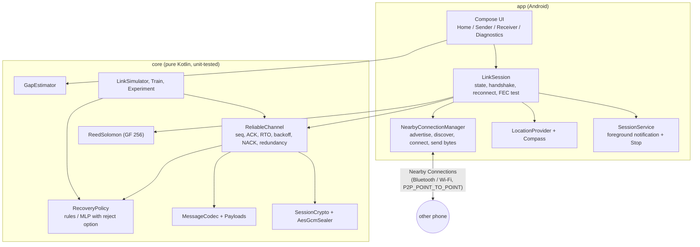
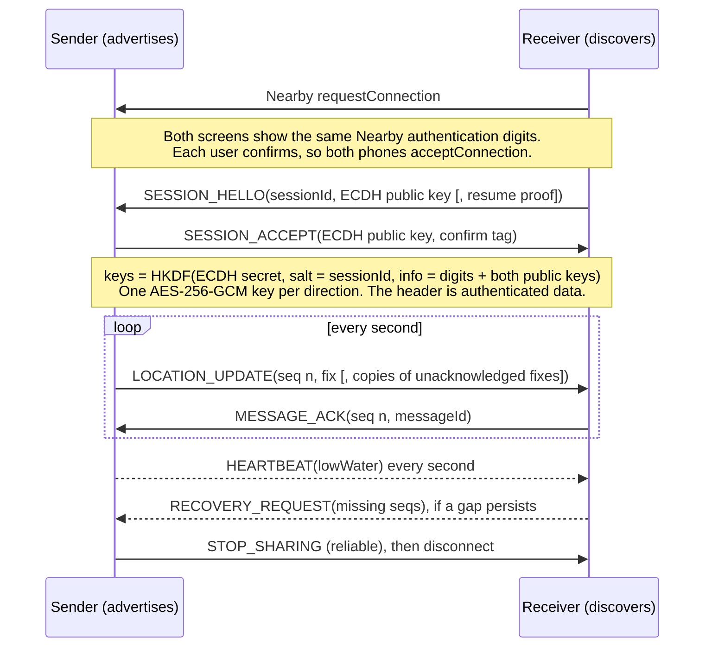

# Architecture

## Layers



The simulator drives the **same** `ReliableChannel` code the app ships, so the measured comparison is of real code over a modelled link.

## Session flow



## Wire format

There is a 47-byte big-endian header, then the body:

```
magic "LF" | version | type | flags | sessionId (8) | senderId (4) | seq (4) | messageId (8) | createdAt (8) | expiresAt (8) | bodyLength (2)
```

- **Header authentication:** the whole header except `bodyLength` is the AES-GCM associated data. Changing any header field fails authentication.
- **Body:** a 12-byte random nonce, the ciphertext and a 16-byte tag. The body is at most 1,024 bytes.
- **Rejected on decode:** bad magic, wrong version, unknown type, length mismatch, oversize, and impossible timestamps (TTL capped at 10 min).
- **Rejected on timing:** messages expired or from the future beyond 5 s of clock skew. The skew is measured against the peer's clock offset, which comes from the handshake timestamps.
- **Rejected after decode:** wrong session, wrong sender, failed authentication, malformed payload, replays and duplicates. The replay check uses a 64-message sliding window.

| Type | Reliable (seq, ACK) | Purpose |
|---|---|---|
| SESSION_HELLO / SESSION_ACCEPT | no (plaintext, handshake only) | key agreement, resume proof |
| LOCATION_UPDATE | yes | fix + up to 4 redundant earlier fixes |
| STOP_SHARING | yes | end the session |
| MESSAGE_ACK | no (idempotent) | up to 32 (seq, messageId) pairs |
| RECOVERY_REQUEST | no (repeated) | up to 32 missing seqs |
| HEARTBEAT | no | sender's lowWater: everything below is delivered or abandoned |
| DATA_CHUNK | no (FEC instead) | one Reed-Solomon shard of a test payload |
| ERROR | no | error code |

## Reliability rules (ReliableChannel)

**Delivery states.** Each message has four separate states, and diagnostics shows each one:
1. **Created:** the app made the message.
2. **Handed to Nearby:** the `sendPayload` call succeeded.
3. **Accepted by the peer app:** it passed decoding, decryption and the replay check.
4. **Acknowledged:** an ACK came back to the sender.

**Timeout.**
- `RTO = SRTT + 4·RTTVAR`, as in RFC 6298, clamped to the range 250 ms to 4 s.
- Round-trip time is only sampled from first transmissions (Karn's algorithm).

**Backoff.** `min(4 s, RTO·2^attempt)`, with half fixed and half random jitter. A message gets at most 4 attempts.

**Locations.**
- **Latest wins:** a new fix supersedes older unacknowledged ones.
- **Expiry:** a location expires after 5 s.
- **Reconnect:** after a reconnect, the old backlog is not sent.

**Control messages.** These are retried with backoff and never superseded.

**Policy decisions.** When a location times out, the `RecoveryPolicy` chooses one of four actions:
- `RETRY_NOW`;
- `WAIT_RETRY` (backoff);
- `ADD_REDUNDANCY` (piggyback this and the next unacknowledged fixes for 5 s);
- `MARK_STALE`.

**Receiver gap handling.**
- **Detection:** a jump in sequence numbers is recorded as a gap.
- **Recovery requests:** a recovery request goes out after 150 ms, is repeated every 600 ms, and is sent at most 3 times. After that the gap counts as "not recovered".
- **Settled gaps:** if a sender heartbeat says a gap is settled (superseded or expired), the receiver stops asking.

**Duplicates.** A duplicate is discarded but acknowledged again, because the original acknowledgement may have been what was lost.

A missing sequence number only means *this app has not seen that message*. It is not evidence of a lost radio packet.

## Reconnect without re-pairing
On a disconnect, both phones keep the previous session's `resume` key for 2 minutes.
1. The receiver rediscovers the sender's advertised name and reconnects. Both phones auto-accept at the Nearby level.
2. The receiver's HELLO includes `HMAC(previous resume key, newSessionId ‖ new public key)`.
3. The sender only starts a session without user confirmation if this proof is valid. Otherwise it disconnects.

## Recovery policy (the AI part)
- **Inputs:** 10 features the app can observe itself:
  - mean and variance of acknowledgement round-trip time;
  - timeout rate, retry success rate, and consecutive timeouts;
  - disconnects in the last minute and queue length;
  - message age, attempt number, and time since the last ACK.
- **Model:** an MLP with 10 inputs, 24 tanh units and 4 linear outputs, evaluated in plain Kotlin. It takes about 1–20 µs on the JVM, and the phone shows its own timing.
- **Output:** each output is the predicted cost of one action: the seconds until the receiver holds this fix or a newer one, plus 0.0005 s per extra byte. The policy picks the cheapest action.
- **Training data:** contextual-bandit style, in `Train.kt`. 400 simulated links take uniformly random actions, and each decision is scored by what actually happened next. Only the taken action's output is trained.
- **Reject option:** after Chow's rule. If the best two predicted costs are within 0.05 s, or an input is more than 6 standard deviations outside the training data, the model abstains and the deterministic rules decide. Abstentions are counted.
- **Safety:** if the model file is missing or incompatible (wrong features, actions or shapes), the app reports "not available" and uses the rules. It never pretends the model is there.

## Gap estimate (not AI)
`GapEstimator` extrapolates from the last fix at constant velocity:
- **Velocity:** the reported speed and bearing, or the change between the last two fixes, capped at 3 m/s.
- **Uncertainty radius:** `accuracy + 1.5 m/s × age`.
- **Withdrawal:** the estimate is withdrawn past 50 m or 60 s.

The UI labels it "Estimated position (NOT measured)" and always keeps the last verified fix and its time.

## Threading and lifecycle
- **Threading:** everything in `LinkSession` and `ReliableChannel` runs on the main thread, which is where the Nearby callbacks, location callbacks and the 100 ms tick coroutine all run. There are no locks.
- **Lifecycle:** `LinkFillApp` owns the single session, so the activity and the foreground service share one connection. Rotation and backgrounding do not create a second connection manager.
- **Foreground service:** a `location` type service with a visible notification and a Stop action. It keeps the session alive with the screen off, and only while a session the user started is active.
