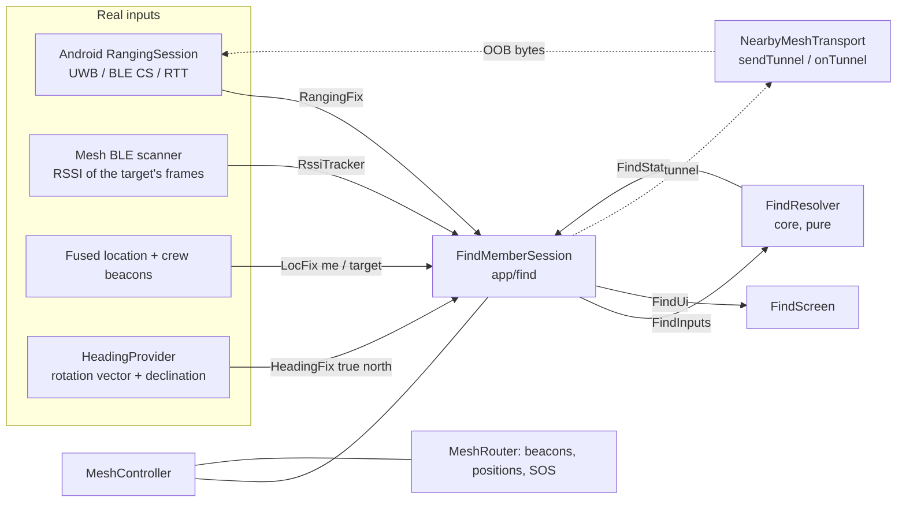

# Find Member: architecture

Companion to [FIND_MEMBER_RESEARCH.md](FIND_MEMBER_RESEARCH.md) (why) and [FIND_MEMBER_TEST_PLAN.md](FIND_MEMBER_TEST_PLAN.md) (how it is checked).

## 1. Principle

**Real hardware supplies ranging, phone sensors orient the interface, the existing mesh carries updates, and the UI states how sure it is.** Nothing is invented: when a source is missing, stale or low-confidence, the claim that depends on it is withheld and the reason is shown.

## 2. Tiers (best to worst)

| Tier | Mode | Needs | Shows | Never shows |
|---|---|---|---|---|
| 1 | `PRECISION_DIRECTION` | Fresh ranging with an **angle** (UWB), confidence not LOW, angle units validated (`trustRangingAngle`) | Arrow from the hardware angle, hardware distance, source and confidence | A metre uncertainty (the API 36 gives only a confidence level) |
| 1b | `PRECISION_DISTANCE` | Fresh ranging distance (UWB, **Channel Sounding**, Wi-Fi RTT), no usable angle | Hardware distance, source, confidence. A GPS arrow only if GPS allows one, labelled approximate | A fabricated angle |
| 1c | `RANGE_WALK` | Fresh hardware distances (any precise technology) from several places along my walked path, an L-shaped or turning path (a straight one leaves a mirror ambiguity), a usable compass, bearing uncertainty ≤ 45° | Arrow with a wedge labelled "direction from walking (estimated)", plus the hardware distance | An arrow from a straight walk, a poor fit (moving target) or an ambiguous fit; instead it says what to do ("turn a corner") |
| 2 | `LOCATION_BEARING` | My fix (≤ 10 s) and the target's fix (≤ 30 s), a fresh heading with uncertainty ≤ 40°, bearing uncertainty ≤ 45° | Arrow with an uncertainty wedge, GPS distance ± the combined accuracy | An arrow when closer than the combined GPS error, or when either fix is old |
| 3 | `BLE_PROXIMITY` | Filtered Bluetooth signal from the target's own frames with confidence ≥ 0.35 | Four closeness bands, signal trend, haptic cue, instructions | Any arrow, any metre figure |
| 4 | `LAST_KNOWN` | An old position | Position, age, a compass word, distance from where I am | An arrow |
| - | `UNAVAILABLE` | Nothing | The reasons | Anything numeric |

**Overrides:**
- Bluetooth `VERY_CLOSE` beats an uncertain GPS arrow, because GPS cannot resolve a few metres.
- Ranging from Android's `BLE_RSSI` technology is **ignored for the precise tiers**: it is a signal-strength estimate, not hardware ranging.
- Mode selection is the pure function `FindResolver.resolve` (core, unit-tested), so the policy is checked without a phone.

### Direction from walking (how, and what it assumes)
Channel Sounding gives distance only, but distances from several places pin down a position. While a session runs, `MotionTracker` finds steps in the accelerometer (`StepDetector`, no extra permission), `StepIntegrator` moves my position 0.7 m along the true heading per step, and each hardware distance is stored with my position at that moment. `RangeBearingEstimator` fits the target position to the last 20 s of (position, distance) pairs (grid search, then Gauss-Newton on the two best basins), and refuses a fit that is ambiguous, poor, from too short a path, or from a path with too little sideways spread. The angular uncertainty comes from the geometry of the walk (range Jacobian) and the compass uncertainty is added.
**Assumptions, none yet validated in the field:** the target stays still for about 20 s; step length 0.7 m (uncalibrated); the heading is the walking direction (phone in hand or on the chest, not in a pocket); distance noise is *assumed* 1 m for the uncertainty maths. It needs real Channel Sounding distances: with no ranging session it never produces anything.

## 3. Component map



| Spec interface | Where it lives |
|---|---|
| `RangingProvider`, `AndroidRangingProvider` | `app/find/AndroidRangingProvider.kt`: `RangingCapabilityProbe`, `AndroidRangingSession`, `TunnelTransportHandle`. Android 16 classes appear only inside these and are reached only behind `Build.VERSION.SDK_INT >= 36`. |
| `BleProximityProvider` | `core/find/RssiTracker.kt` (filter, trend, bands, confidence), fed by `MeshRouter.rssiObserver` in `MeshController` |
| `HeadingProvider` | `app/find/HeadingProvider.kt` over `core/find/Orientation` and `Angles` |
| `LocationBearingProvider` | `core/find/Bearing` and the GPS branch of `FindResolver` |
| `CrewPresenceManager` | The crew list in `MeshController` (beacons carry a `findable` bit, meaning this phone can be ranged) plus `FindMemberSession.Host` |
| `FindMemberViewModel` | `FindMemberSession` (a plain class owned by `MeshController`, matching the project's controller style; it exposes `StateFlow<FindUi>`) |
| Capability resolver | `RangingCapabilityProbe` (platform query) plus `FindMemberSession.beginRanging` gates; chooses nothing from "has Bluetooth" |
| Simulated provider | **Tests only** (`core/src/test/.../FindTest.kt`) and the **debug-only** `FindPreviewActivity`, whose screen is stamped "SIMULATED DATA - NOT A MEASUREMENT". Neither exists in release builds. |

## 4. The ranging session over the mesh's Nearby link

Android's default out-of-band ranging needs the app to provide a bidirectional byte pipe (`TransportHandle`) between the two phones. We provide it as an **authenticated tunnel over a direct Nearby connection** to the target.

**Start is automatic.** Being in the same group is consent, so there is no switch. The finder starts a session when the target is within about 40 m. That means either the target's frames are heard directly over Bluetooth with filtered RSSI of -85 dBm or stronger, or both fresh GPS fixes are within 40 m. Until then the session waits in the link phase `WAITING_FOR_RANGE`.

```mermaid
sequenceDiagram
    participant F as Finder
    participant T as Target
    F->>F: wait (WAITING_FOR_RANGE) until within about 40 m; start Nearby; check target.findable, API 36, permission, capabilities
    F->>T: tunnel REQUEST (sealed, 30 s freshness)
    alt target allowed, supports ranging
        T->>T: start responder RangingSession; show "X is finding you" with a Pause for 30 minutes button
        T->>F: ACCEPT
        F->>F: start initiator RangingSession (OOB)
        loop negotiation
            F-->>T: DATA (ranging module bytes)
            T-->>F: DATA
        end
        T--)F: (platform) ranging results go to the initiator only
    else declined / unsupported
        T->>F: DECLINE (reason)
    end
    F->>T: STOP when the screen closes
```

- **Tunnel (`core/find/Tunnel.kt`):** frame `'R' | from | to | sealed`. AES-256-GCM under a crew-derived **tunnel key** (HKDF output separate from the packet key, random nonces), with the 9-byte header as associated data, and a 30 s freshness check inside the plaintext. A frame cannot be redirected to another recipient, replayed after 30 s, or read by another crew (all unit-tested).
- **Addressing:** endpoint names are `khoj-<node id>`, so the sender finds the right Nearby connection and the receiver ignores frames not addressed to it.
- **Consent:** being in the same crew is consent. There is no precise-finding switch. The beacon's `findable` bit means only that this phone can be ranged (Android 16, the ranging permission and the hardware). The target sees "X is finding you" on its home screen and in a notification, with a **Pause for 30 minutes** button. Pausing ends the running session and declines new ones for 30 minutes.
- **Fallbacks:** no direct Nearby link, unsupported hardware, a declined request or no permission leave the session in an explained state, and the screen continues with GPS and Bluetooth tiers.

## 5. Data and timing

- **Evaluation:** `FindMemberSession.evaluate` runs on the 250 ms loop and on every heading event (rate-limited to about 16 Hz).
- **Freshness thresholds** (all constants in `FindResolver`): ranging 3 s; my fix 10 s; target live 10 s / recent 30 s; heading 2 s.
- **Arrow smoothing:** `AngleSmoother` (exponential smoothing with a 250 ms time constant, unwrapping across ±180° so the arrow never spins the long way). The hardware arrow is also corrected for how far the phone has turned since the measurement.
- **Haptic cue:** `ImprovementCue` fires only after 3 consecutive "improving" evaluations and at most every 4 s, and only in Bluetooth proximity mode.
- **Automatic start:** precise ranging begins when the target is within about 40 m (`PRECISE_RANGE_M`), by Bluetooth RSSI of -85 dBm or stronger after filtering, or by both fresh GPS fixes within 40 m. Before that the phase is `WAITING_FOR_RANGE`. The rule is written but not yet unit-tested or run between two phones.

## 6. Privacy, security and safety

| Concern | Handling |
|---|---|
| Consent | Crew membership is explicit (crew code or QR). Being in the crew is consent for precise finding, with no separate switch. The target is told whenever a session runs and can pause it for 30 minutes. |
| Who can find me | Only members of the same crew (tunnel key and beacon decryption). A relay phone forwards ciphertext and learns nothing. |
| Authenticity | Tunnel frames are authenticated (AES-GCM). The ranging session itself uses the platform's security level (`BASIC`; CS level choice is an open question). |
| Retention | Positions are kept in memory only. The diagnostic log holds measurements and a random session id, **no coordinates and no names**. |
| Identifiers | A fresh node id per run; crew tag is the only stable identifier on air (documented limitation). |
| Stop | Closing the Find screen, the target pausing (30 minutes), either side leaving, or stopping the mesh sends `STOP` and ends the session. |
| Background | Android allows non-UWB ranging only in the foreground. The mesh runs as a foreground service with a visible notification. |

## 7. Feature compatibility matrix

"Observed" means checked on a real phone in this project. "Unverified" means implemented but not yet run on that hardware.

| Capability | iQOO I2501 (SM8850, Android 16) | Any Android 16+ phone with UWB | Android 10-15 phone | Notes |
|---|---|---|---|---|
| Ranging module present | **Observed** (capabilities returned) | Expected | No (needs API 36) | Version-gated at run time |
| UWB distance | Not supported (**observed**) | Expected, unverified | No | |
| UWB angle / hardware arrow | Not possible | Implemented but **disabled until units validated** | No | Needs a UWB phone to validate |
| BLE Channel Sounding distance | **Enabled** (observed); session **unverified** | Phone-dependent | No | Distance only; both phones must support it; foreground only |
| Wi-Fi NAN RTT | Not supported (**observed**) | Phone-dependent | No | |
| GPS bearing with uncertainty | Implemented; **unverified in the field** | Same | Same | Needs outdoors and a compass |
| BLE signal proximity + trend | Implemented; **unverified with two phones** | Same | Same (needs BLE 5 extended advertising for the mesh) | Bands are uncalibrated defaults |
| Last known position | Implemented | Same | Same | |
| Mesh carries position updates | Implemented | Same | Same | Relay delivers positions, not bearings |
| Compass heading, any posture | Unit-tested; **unverified in the field** | Same | Same | |

## 8. Where AI belongs (after the baseline)

The first version is deterministic on purpose. A learned component is only worth adding where the baseline measurably fails. Candidates, in order of expected value:
1. **RSSI trend / proximity classification** from the same features the logger already records (filtered level, slope, standard deviation, orientation).
2. **Outlier rejection for ranging samples** using confidence flags and history.
3. **Reconnect and retry selection** (reuse the existing recovery-policy machinery).

Protocol: record the baseline on held-out *devices and sessions* (not random rows), report precision-recall against the deterministic trend rule, and keep every learned output behind the same confidence gates. No model is trained or shipped yet; nothing here may be used to create angles that the hardware did not measure.
